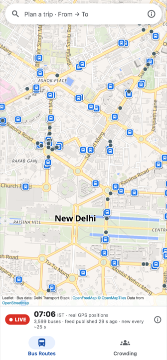
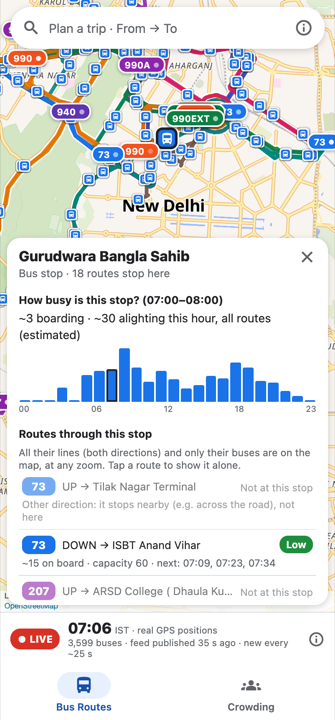
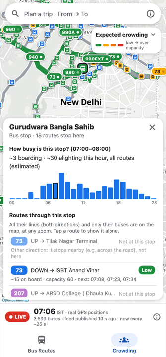
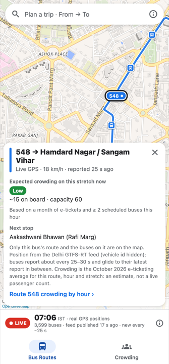
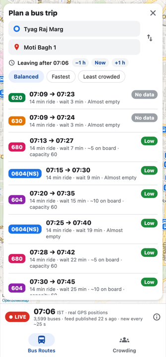
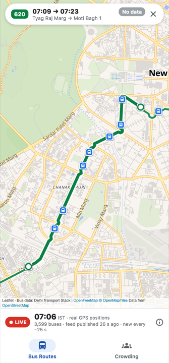

# Delhi Bus Crowding — mobile prototype (Problem 2)

A Google-Maps-style mobile app for the **crowdedness-aware journey planner** (Transport Stack
Hackathon 2026, Problem 2). It covers **every Delhi bus stop and route** and shows **every live
bus** from the real-time GPS feed. Routes, buses and stops show how crowded they are **expected**
to be, estimated from a month of real e-ticketing data, and the planner ranks buses between any two
stops (direct or with one change) by time and crowding.

| Nearby (zoomed in) | Tap a stop | Crowding | Tap a bus | Plan a trip | Chosen trip |
|---|---|---|---|---|---|
|  |  |  |  |  |  |

## What it does

- **The map** shows real GPS positions of all ~2,000–6,000 buses in the Delhi GTFS-RT feed and
  all ~6,800 stops, depending on zoom and selection:
  - **Zoomed out (below zoom 14), nothing selected:** just the map, with a "Zoom in" hint.
  - **Zoomed in:** the stops and live buses in view. Stops are blue bus-stop signs (the tapped
    one bigger, with a dark outline). With up to 60 buses on screen they are labelled chips
    (route number); with more they are dots.
  - **Tap a stop:** every route number through it, in **both directions** (the other direction
    often uses the stop across the road), one colour per route number, with the stops along them.
    **Only buses on those routes** are drawn, at any zoom, so zooming out keeps this view. The
    sheet shows how busy the stop is by hour and lists each route: where it goes, how full its
    buses arrive now and the next departures. Tap a route to show it alone, and again (or
    "Show all routes") to go back.
  - **Tap a bus:** only its route and the buses on that route, with a sheet showing its speed,
    how old its GPS report is, the expected crowding where it is and its next stop.
  - The selection is cleared only by **closing its sheet** (✕) or **Android Back**. Tapping the
    map elsewhere does nothing, so you can pan and zoom freely.
- **Bottom bar:**
  - **Bus Routes:** selected routes in their own colours.
  - **Crowding:** muted basemap. Buses are coloured by the expected crowding where they are
    now; the selected routes stretch by stretch for the current hour; their stop signs by how
    full arriving buses are (Seats available / Standing room / Crowded / Packed, grey = no tickets). "Route … crowding
    by hour" opens a 24-hour chart with the capacity line.
- **Plan a trip (From → To):** search any stop (same-named stops across the road count as one).
  - Lists buses leaving in the next 2 hours from the GTFS timetable: departure, arrival, ride and
    wait time, plus the crowding on the busiest stretch of *your* ride.
  - **Trips with one change** when no single bus goes there, or when changing is faster: change at
    the same stop or walk up to 250 m, with at least 2 min to change and at most 30 min to wait.
    The row shows both route numbers ("801 › 774"), where to change and the wait; crowding is the
    busier of the two buses. Options another option beats on every count are dropped.
    In a sample of 300 trips of 2–20 km at 09:00 on a weekday, 23 % had a direct bus and 94 % had
    a direct bus or a trip with one change.
  - Change the time with −1 h / Now / +1 h. Sort by **Balanced** (adds 0/4/10/18 minutes for
    seats available / standing room / crowded / packed and 5 minutes per change), **Fastest** or
    **Least crowded**.
  - If the fastest bus is High or Very High, it suggests a less crowded one (with as many
    changes) up to 45 min later.
  - Choosing an option shows its routes and highlights each ride.
- **Live feed:**
  - The app checks the server every 2 s and redraws the buses several times a second. The server
    snaps each GPS report onto the bus's route line, and the bus glides from where it is drawn to
    its newest report **along that line**, so it stays on its road instead of cutting across
    blocks between reports (the map fetches the route lines of the buses on screen).
  - A bus more than 200 m from its route (depots, diversions; ~10 %) or on a route missing from
    GTFS has no line to follow: it stays at its latest raw GPS report and hops to the next one in
    1.5 s.
  - Positions can't be fresher than the source: Transport Stack publishes the feed about every
    25 s, each bus reports about every 25–30 s, and a report is already ~25 s old (median) when
    it appears. A bus whose device reports only every few minutes glides more slowly between
    reports; a bus with no new report for several minutes is drawn faded.
  - The status bar shows the Delhi time, the bus count and the feed age. Tap it to change the
    server address.

## Run it on your phone (no Android Studio / Xcode)

The app needs our small Python server for everything except the basemap, so start that first
(next section). Then you need Node.js ≥ 20 (we use v22 via nvm) and the free **Expo Go** app
(Play Store / App Store):

```bash
cd mobile-implementation
npm install          # also builds the map page (postinstall → scripts/build-map.mjs)
npm start            # rebuilds the map page, then starts Expo and shows a QR code
```

- **Android:** open Expo Go and scan the QR code. **iPhone:** scan it with the Camera app.
- The phone and the Mac must be on the same Wi-Fi. If not, use `npm start -- --tunnel`.
- **Web** (any browser, including iPhone Safari): `npx expo start --web`, or
  `npx expo export --platform web` for a static site in `dist/`.

## Start the server

The Transport Stack GTFS-RT API key must **never** be in the app, because anyone can unpack an
app bundle. So the phone talks to a small Python server on your Mac, and only the server holds
the key. It also serves every stop, route, crowding estimate and timetable lookup. Run it from
the repo root:

```bash
conda activate transport-stack                 # needs fastapi + uvicorn from requirements.txt
python src/api/main.py                         # http://0.0.0.0:8787 (about 10 s to load all routes)
```

- **Requirements:**
  - The raw data in `../data/` and the crowding outputs, including the per-stop busyness file
    (`python src/model/crowding.py`; see "Where the data comes from").
  - `../.env` (repo root, gitignored) with `TRANSPORTSTACK_API_KEY=…`, plus optionally
    `TRANSPORTSTACK_RT_URL=…`. Don't put the key in `mobile-implementation/.env`: Expo reads that
    file when bundling the app. Without a key, stops, routes and the planner still work, but
    there are no live buses.
- **Finding the server:** the app looks for it on the Mac that runs `npm start` (port 8787),
  so on the same Wi-Fi it just works in Expo Go. Otherwise set
  `EXPO_PUBLIC_LIVE_API_URL=http://<mac-ip>:8787` in `mobile-implementation/.env` (a URL, not
  a secret), or type the address in the sheet that opens from the status bar.
  - With `npm start -- --tunnel`, the phone can't reach the Mac directly; use that sheet with an
    address the phone can reach.
- **Upstream traffic:** the server learns when the feed is published (about every 25 s) and
  fetches it just around that time over one kept-open HTTPS connection: about 3 requests a
  minute whatever the number of phones, with each new feed picked up within a few seconds.
  Phones ask `/api/live?since=…` and get an empty `204` until there is a newer feed. Vehicle ids
  (registration plates) are replaced with hashes.
- **Endpoints** (times `t` are seconds since midnight in Delhi; default now):
  - `/api/live`: all buses, snapped to their route, with expected crowding.
  - `/api/stops`: every stop a route stops at (~360 KB, ~120 KB gzipped; loaded once).
  - `/api/stops/1628?t=`: one stop's busyness by hour and every route number through it, both
    directions, with crowding of arriving buses and the next departures.
  - `/api/routes?ids=623UP,623DOWN` (or `/api/routes/623UP`): shapes, stops and 24-hour crowding.
    The busiest stop (ISBT, 268 route variants) needs ~490 KB gzipped; a typical one ~50 KB.
  - `/api/shapes?ids=623UP,181UP`: route lines only (~1.5 KB gzipped each), for moving the buses
    on screen along their road.
  - `/api/plan?from=3969&to=4043&t=&transfers=1`: buses between two stops in the next 2 hours,
    direct or with one change (without `transfers=1`: direct only, as older app builds expect).
  - `/api/health`: server and feed status.
- **Native builds:** Expo Go allows plain `http://` to your Mac. A standalone Android build
  blocks it unless cleartext traffic is enabled (`expo-build-properties`), so host the server
  over HTTPS for anything beyond a local demo.

## Where the data comes from

The app bundles only `assets/data/meta.json` (~1 KB, committed): the attribution and the crowding
model's assumptions, exported by `src/export_mobile_data.py`. Everything else comes from the server,
which reads the raw data in `data/` (gitignored; see `../data/README.md`) and the model outputs.
Regenerate them from the repo root:

```bash
conda activate transport-stack            # or the venv from the root README
python src/resolve_stops.py               # e-ticket stop names -> GTFS stops
python src/model/crowding.py              # crowding by route/day type/hour/segment + stop busyness by hour
python src/export_mobile_data.py          # -> mobile-implementation/assets/data/meta.json
```

The server sends only derived, aggregated data: simplified route shapes, crowding estimates,
stop busyness and timetable lookups. No raw ticket rows, and live vehicle ids are hashed.

## How crowding is estimated (and what it is not)

- Each e-ticket records the boarding **and** alighting stop. Along a route's stop order,
  `load = Σ boardings − Σ alightings` gives the monthly load on every segment.
- This is scaled to one bus by `1 / 4.5 %` (mobile-ticket share) and `1 / scheduled trips` in
  that hour, then divided by a capacity of 60 to get occupancy. Levels (shown to riders as Seats
  available / Standing room / Crowded / Packed): <50 % Low, 50–80 %
  Medium, 80–100 % High, >100 % Very High.
- **Day types:** weekdays, Saturdays and Sundays/public holidays differ a lot (at 09:00 a Sunday
  carries about a third of a weekday's riders). Each route-hour is scaled to the kind of day the bus
  runs on by the B2 demand model (`src/ml/demand.py`), which beat today's monthly average by 27 % on
  a held-out week. The server picks the day type from the Delhi date; a bus after midnight gets the
  next day's. The app needs nothing for this, but it caches route sheets for the session, so a
  session that crosses midnight into another day type shows the old values until reload.
- **Low confidence** = fewer than 2 scheduled buses a day in that hour, or fewer than 30 ticketed
  passengers in the month for that route-hour.
- It is an **expected October average for that kind of day**, not a live passenger count. The app
  says so wherever a number appears. Bus positions are **real GPS**, but crowding is still the
  October expectation for that route, hour, stretch and day type.
- **Validation:**
  - At 06:21 on 13 Nov the timetable had 2,735 trips running and the live feed 2,483 buses
    (90.8 %), so the timetable used by the planner matches what actually runs.
  - Crowding peaks at 08–09 and 18–19.
- **Live coverage** (19 Nov, around 11:00 IST): 6,118 buses in the feed. 88 % sat within 200 m
  of their route line and got a crowding estimate; 11 % were farther away (depots, diversions,
  shape gaps) and 1 % ran routes missing from the GTFS timetable.
- **Known limitations:**
  - The flat 4.5 % coverage over-scales some routes (e.g. 717A peaks at 7.6× capacity on weekdays at
    08:00); ETM data would fix the scaling. Until then the app shows "Over capacity" instead of a
    passenger count above 1.5× capacity; the level (Very High) and the ranking between routes stand.
  - Routes are matched to stops by each route's longest trip, so a variant that stops somewhere
    only on shorter trips is missed (rare).
  - At the busiest stops (100+ route variants) the lines overlap heavily; tap a route in the
    sheet to see it alone.

## How it is built

```
App.tsx (React Native)                        map page (WebView / iframe on web)
 ├─ TopBar · Legend · LiveBar · BottomNav      map/main.ts — Leaflet overlays on a MapLibre basemap
 ├─ details.tsx (stop / bus / route sheets)    ├─ stops in view, routes of the selection, trip ride
 ├─ JourneyPanel (planner, GET /api/plan)      ├─ map/live.ts — live buses (canvas dots or chips)
 ├─ live/ api.ts + useLiveFeed.ts (2 s)        └─ posts taps on stops / buses + zoom changes
 └─ MapView.tsx ── MapCommand (stops, focus, live data, mode) ──►  ◄── MapMessage (ready / zoom / tap)
src/logic/  focus.ts · crowding.ts · planner.ts · lookup.ts · live.ts · shape.ts · time.ts
            (pure TS, shared by the app, the map page and the tests)
scripts/build-map.mjs  esbuild → src/map/mapHtml.generated.ts (+ .local/map-preview.html)

../src/api/  (Python server)  main.py FastAPI · feed.py GTFS-RT poller · network.py all routes:
             geometry, snapping, crowding, stop index, timetable, planner (helpers in ../src/data/routes.py)
```

- **What the map draws** is decided by `src/logic/focus.ts` (tested): a selection (stop, bus or
  chosen trip) becomes a `MapFocus` with its routes, the buses to keep and the pinned stop.
  Route details are fetched in one batch and cached.
- **Performance:** only stops and buses in (or near) the view are drawn. Stops and bus dots share
  one canvas, because Leaflet only delivers taps to the topmost canvas. The stop signs
  (`map/stopIcon.ts`) are drawn on it from a pre-rendered image per look, so hundreds stay cheap.
  Route lines use another canvas, with one multi-line per crowding colour per route.
- The basemap's own OpenStreetMap bus-stop icons are hidden: they looked like our signs but
  couldn't be tapped and don't match the GTFS stops. Rail and airport icons stay.
- The map runs in a WebView, so it works in Expo Go without native map modules.
- **Live movement:** the server snaps each GPS fix onto its route (distance along it and the
  segment it is on) and sends the bus's previous fix too, so buses move from the first response.
  `src/logic/live.ts` interpolates between fixes by distance along the route line. The map page
  asks React Native (`needShapes`) for the lines of buses on screen it doesn't have and caches
  them. Measured in central Delhi: gliding buses stay within ~2 m of their line, whereas straight
  interpolation left 13 % of moves more than 15 m off the road (up to ~200 m at bends).
- Basemap: **OpenFreeMap** vector tiles, which are free with no key or usage limits. They use
  "liberty" for routes and the muted "positron" for crowding. (`tile.openstreetmap.org` blocks
  WebView requests and CARTO now needs a key.)
- `.local/map-preview.html` opens the map page alone in a desktop browser, with a small dev panel.
  It reads stops and live buses from a server on `localhost:8787`, and tapping a stop selects it.
  `window.__app.probe()` reports what the page is drawing.

## Checks

```bash
npm test             # focus (what the map shows), planner, live-tracking and stop-search tests
npm run typecheck    # tsc --noEmit
npm run lint         # expo lint
npx expo-doctor      # Expo SDK / dependency health
```

## Credits

- **Data:** Delhi Transport Stack (Department of Transport, GNCTD), used under the Transport Stack
  data License Agreement v1.0. Derived and aggregated by the team; the changes are listed in
  `assets/data/meta.json` → `changes`. Live positions: Delhi Buses GTFS-RT feed (Transport Stack).
- **Basemap:** [OpenFreeMap](https://openfreemap.org), © [OpenMapTiles](https://openmaptiles.org),
  map data © [OpenStreetMap](https://www.openstreetmap.org/copyright) contributors.
- **Libraries:**
  - Expo and React Native (MIT), expo-constants (MIT)
  - react-native-webview (MIT), react-native-safe-area-context (MIT)
  - @expo/vector-icons (MIT; Material Icons, Apache-2.0); the map's stop sign uses the Material
    Icons bus symbol (Apache-2.0)
  - Leaflet (BSD-2-Clause), MapLibre GL JS (BSD-3-Clause), MapLibre GL Leaflet (ISC),
    Leaflet.PolylineOffset (MIT)
  - esbuild (MIT), Jest / jest-expo (MIT)
  - Live server: FastAPI (MIT), uvicorn (BSD-3-Clause), gtfs-realtime-bindings (Apache-2.0),
    pandas / NumPy (BSD-3-Clause)
- **AI tools:** developed with the help of GitHub Copilot (AI coding assistant).
